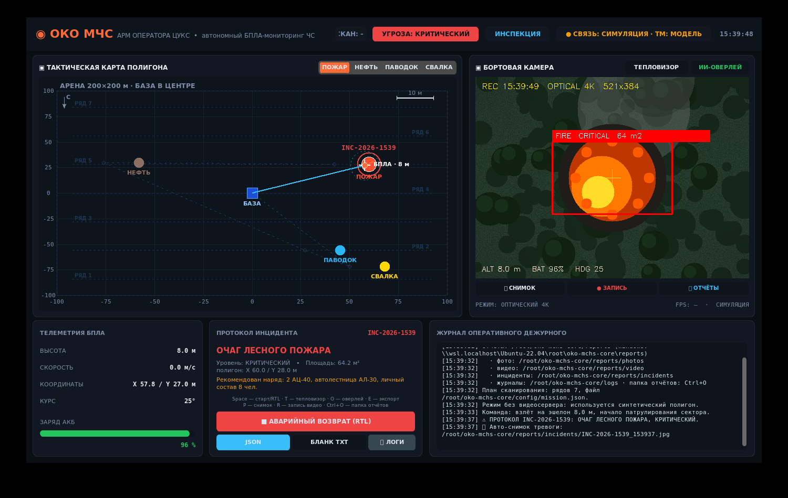

# АРМ ОПЕРАТОРА ЦУКС «ОКО МЧС»

Тактический пульт оперативного дежурного: живое видео с борта, карта полигона,
телеметрия, автоматический приём протокола инцидента, фото- и видеофиксация,
экспорт документов и диагностика комплекса.



## Запуск

```bash
# из корня репозитория
python3 src/mchs_ui/app.py                 # обычный режим (ждёт видеосервер борта)
python3 src/mchs_ui/app.py --offline       # без видеосервера: синтетический полигон
python3 src/mchs_ui/app.py --offline --autostart   # сразу демонстрационный полёт
```

Зависимости: `customtkinter`, `Pillow`, `opencv-python`, `numpy`.
На Windows: `pip install customtkinter pillow opencv-python numpy`.

## Что на экране

| Блок | Содержимое |
|---|---|
| Шапка | бренд, канал связи, уровень угрозы, фаза миссии, состояние связи с бортом, часы |
| Карта | арена 200×200 м с базой в центре, 7 плановых рядов сканирования из `config/mission.json`, маршрут облёта очагов, очаги ЧС, живой БПЛА с треком и курсом, отметка инцидента, масштабная линейка, компас |
| Камера | поток с борта, тепловизор, ИИ-оверлей с рамкой детекции и служебными подписями, кнопки «СНИМОК / ЗАПИСЬ / ОТЧЁТЫ» |
| Телеметрия | высота, скорость, координаты X/Y, курс, заряд АКБ |
| Протокол | номер инцидента, тип ЧС, уровень угрозы, площадь, WGS-84 и координаты полигона, рекомендуемый наряд, кнопки JSON / БЛАНК TXT / ЛОГИ / аварийный возврат |
| Журнал | оперативные события с отметками времени и запись в `logs/` |

## Источники данных

1. **Видео.** Основной режим — MJPEG `/stream` с веб-сервера ноды зрения
   (`http://127.0.0.1:8080`). Если поток не поднимается, пульт переходит на
   опрос `/snapshot.jpg`, а при полном отсутствии связи рисует синтетический
   полигон — демонстрация не зависит от Gazebo.
2. **Живая телеметрия.** Опрос `/state.json` ноды зрения (высота, координаты,
   курс, заряд, фаза миссии). Данные старше 2 секунд считаются устаревшими,
   и пульт возвращается к модели полёта — «зависший» сервер не выдаётся за борт.
3. **Протокол.** Пульт сам замечает новый `reports/incident_protocol.json`
   (его пишет автопилот `mchs_control` при зависании над очагом) либо
   `src/mchs_ui/incident_protocol.json` (ручной экспорт). Появление файла
   включает тревогу, звуковой сигнал, подсветку очага на карте, заполнение
   карточки инцидента и авто-снимок в `reports/incidents/`.
4. **Демонстрационный режим.** Если борт не подключён, АРМ ведёт модель полёта
   по тем же рядам сканирования, а при выходе на выбранный объект сама
   формирует протокол в `reports/` — ровно в той же схеме, что и автопилот.

## Горячие клавиши

| Клавиша | Действие |
|---|---|
| `Space` | старт патрулирования / аварийный возврат (RTL) |
| `T` | тепловизор (палитра INFERNO + CLAHE) |
| `O` | ИИ-оверлей детекции |
| `E` | экспорт протокола JSON |
| `P` | снимок кадра в `reports/photos/` |
| `R` | запись видео в `reports/video/` |
| `Ctrl+O` | открыть папку отчётов |
| `D` (или `Ctrl+D`) | диагностический бандл логов |
| `F11` | полный экран |
| `Esc` | выйти из полного экрана |

Мышь: маркер очага на карте можно перетащить в любую точку арены — новые
координаты сохраняются в `config/hazards.json` и передаются в Gazebo, так что
сценарий ЧС меняется прямо во время демонстрации.

## Экспорт и отчёты

Кнопки «JSON» и «БЛАНК TXT» сохраняют документы в `reports/`:

* `incident_protocol_ГГГГММДД_ЧЧММСС.json` — машиночитаемый протокол;
* `incident_protocol_ГГГГММДД_ЧЧММСС.txt` — печатный бланк дежурного с местом подписи.

Раскладка каталогов:

* `reports/incidents/` — протоколы и авто-снимки тревог;
* `reports/photos/` — снимки оператора;
* `reports/video/` — видеозаписи полёта;
* `logs/` — журналы и телеметрия BlackBox.

## Тесты

```bash
python3 src/mchs_ui/tests/test_app_data.py
```

Проверяются разбор обоих форматов протокола, пороги уровней угрозы, печатный
бланк и отслеживание нового файла — без открытия окна.
